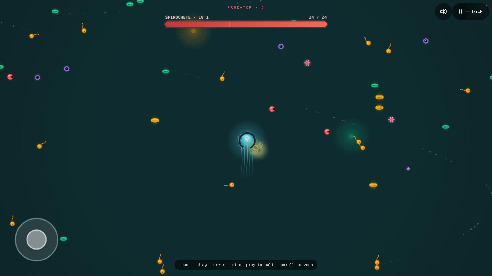

# Cytogenesis

Roguelike cellular-automation game. Pilot a single mobile core node through a primordial sea (or proto-galactic medium); free-floating cells get captured by colliding with your graph and bond in via force-link edges. Adjacency between captured nodes runs a local-rule trait CA that produces emergent abilities.

Two themes (aquatic / galactic), two CA layers (environmental + trait), fully client-side.



Live: [cytogenesis.vercel.app](https://cytogenesis.vercel.app)

## Stack

- Next.js 16 (App Router, Turbopack) + TypeScript + Tailwind 4
- React 19.2
- d3 (force, drag, zoom) for the entity graph
- Canvas 2D for rendering — single context, layered draws
- Custom velocity integrator + quadtree for ~500–1000 free agents
- Zustand (live state) + idb (persistent meta-progression)
- Vitest + jsdom for unit tests

## Run

```bash
pnpm install
pnpm dev      # http://localhost:3000
pnpm test
pnpm build
```

## Architecture

Three independent simulation layers, never crossed:

| Layer | Population | Mechanism | Tick |
|---|---|---|---|
| Entity graph | ≤80 nodes | d3-force + `forceLink` bonds | rAF |
| Free agents | 500–1000 cells | custom integrator + quadtree | rAF |
| Environmental CA | 128² toroidal grid | Conway B3/S23 | 4 Hz |
| Trait CA | graph-local | recomputed on mutation only | on capture/loss |

Theme is paint, not logic — node-type IDs (`propulsion`, `sensor`, `membrane`, `mouth`, `stinger`, `chloroplast`, `mitochondrion`, `spore`, `core`) are theme-neutral and resolved through `src/data/themes.ts`. Determinism is enforced via a seeded PRNG (`src/lib/rng.ts`); every run's seed is surfaced in the summary.

## Phase tracker

- [x] Phase 0 — scaffold, canvas, rAF loop, FPS HUD
- [x] Phase 1 — d3 drag/zoom + core node + free cells
- [x] Phase 2 — capture + graph growth
- [x] Phase 3 — free-agent population + quadtree + arena wrap
- [x] Phase 4 — environmental CA (Conway B3/S23 @ 4 Hz, 128² toroidal)
- [x] Phase 5 — trait CA + abilities
- [x] Phase 6 — predators, prune cascade, transcend@80 / death, run timer
- [ ] Phase 7 — meta-progression (idb)
- [ ] Phase 8 — both themes
- [ ] Phase 9 — polish (Lenia, audio, mobile)

MVP = Phases 0–6.

## License

Private — all rights reserved.
